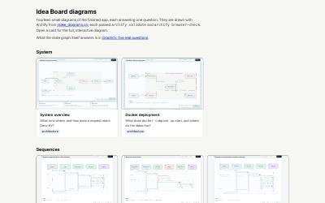
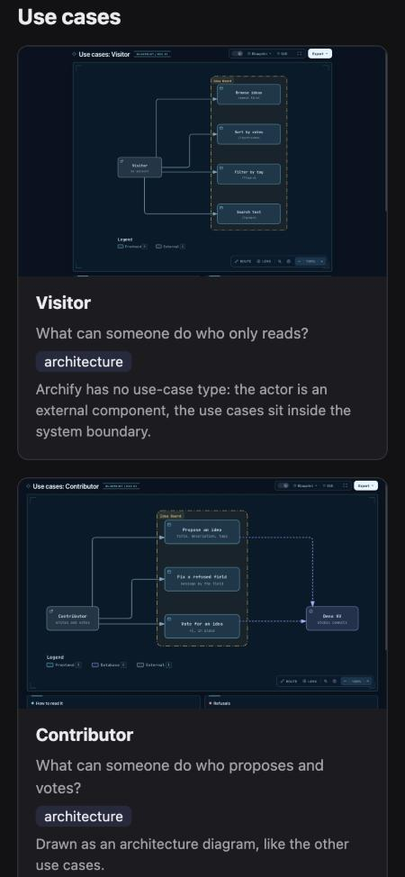

# Round 07: Graphify use cases and the Archify gallery

**Brief:** [`../../plan/07-architecture.md`](../../plan/07-architecture.md).
**Result:** done.
- The Graphify graph of the finished app answers five real questions, each shown with its command
  and real output.
- The gallery holds 14 Archify diagrams. Every one passes `archify validate` (0 errors, 0 warnings)
  and `archify browser-check --quality showcase`.
- The owner said "Yes, round 7" before this round started.

Everything was in `demo/claude_code/render/`, removed when the run was archived; read it with
`git show 578f4f3:demo/claude_code/render/index.html` (the gallery) and
`git show 578f4f3:demo/claude_code/render/graphify/use-cases.md` (the Graphify answers).

## 1. Plan
Slices:
1. The graph: a manifest of `app/` and the three `idea-board-*` specs, built with the factory's own
   `tools/architecture/graph.py`.
2. The questions: `graphify explain` and `graphify path` for the first two, and a small script
   (`questions.py`) for the three that need the whole graph.
3. The diagrams: one generator (`make_diagrams.py`) that writes the 14 Archify inputs, then
   `validate`, `render` and `browser-check` on each.
4. The gallery: one static page, no CDN, light and dark, a live thumbnail per card.

## 2. Versions
No install for this round: it reuses the parent's `.aeion/`.
- Graphify 0.9.95, the version pinned by the factory, in `.aeion/integrations/graphify-venv`.
- Archify, the clone at `81c6be8d` (2026-10-25), with Node and Chrome for `browser-check`.

## 3. Graphify
```bash
.aeion/integrations/graphify-venv/bin/python tools/architecture/graph.py demo/claude_code/workspace \
  demo/claude_code/render/graphify demo/claude_code/render/graphify/manifest.json
# 205 nodes, 363 edges; 38 required source/docs files covered.
```

| Question | Answered by | What it showed |
| --- | --- | --- |
| What breaks if I change the store? | `graphify explain` | 6 production files; `VoteButton` only by the `Sort` type |
| How does a POST reach KV? | `graphify path` ×4 | the full path, except the `ideas.create(...)` method call, which structural extraction does not resolve |
| Which files have no test? | `questions.py` | importing is not reaching: only the wiring (routes, `main.ts`, `serve.ts`, `shared.ts`, `kv.ts`) is reached by no test |
| Which spec covers a file? | `questions.py` | the graph links 6 files and each file's `Spec:` header names a spec for 18: **FB-010** |
| Where should a newcomer start? | `questions.py` (degree) | `home.tsx`, `ideas.ts`, `testing.ts`, `app.ts` |

## 4. Archify: where I got stuck
| Diagram type | Cause | Fix |
| --- | --- | --- |
| sequence | a participant cannot message itself | internal steps moved into the message label or a note card |
| sequence | messages closer than 28 px fail validation | `make_diagrams.py` places them 32 px apart and computes the activations |
| sequence | a fixed `viewBox` cut off long sequences | `viewBox` omitted, so the diagram grows |
| erd | the domain band must be one solid block | both index entities moved to column 0 |
| workflow | schema 1 allows few columns and let boxes overlap; edge roles are fixed | `schema_version: 2`; roles limited to main, branch, async, return, error |
| use cases | Archify has no use-case type | each actor is an external component, its use cases sit inside a system boundary |

None of the diagrams carries evidence links: Archify's `sources` need a git SHA and an http URL,
and the copy has neither (FB-001, seen again).

## 5. Batteries
```text
archify validate   × 14   ok (0 errors, 0 warnings)
archify render     × 14   ok
browser-check      × 14   "ok": true  (receipts in render/diagrams/*.browser-check.json)
gallery            14 of 14 iframes render their SVG; no horizontal scroll at 1440 light or 375 dark
copy: knowledge-check PASS, doc-links PASS (91 links), repo-health: AGENTS.md 120 lines
```




## 6. Known limits
- Each rendered diagram is a self-contained page of about 840 KB, 12 MB for the 14.
- The thumbnails are live iframes scaled to a quarter, so the gallery loads all 14 pages. They are
  lazy, but a slow machine still feels it.
- The use-case diagrams are architecture diagrams dressed as use cases, not UML.

## 7. Feedback from this round
- **FB-010** (medium), new: the graph ignores each spec's `sources`, so it gives a wrong answer to
  "which spec covers this file".
- **FB-001**, seen again: no evidence links without git.
- **FB-007**, seen again: at the 250k alert the shell's working directory was `render/`, so the
  checkpoint had to be run by the owner from the root.
- What worked: one generator for 14 inputs turned each Archify rule into one fix, made once.
