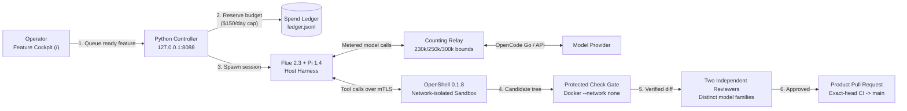
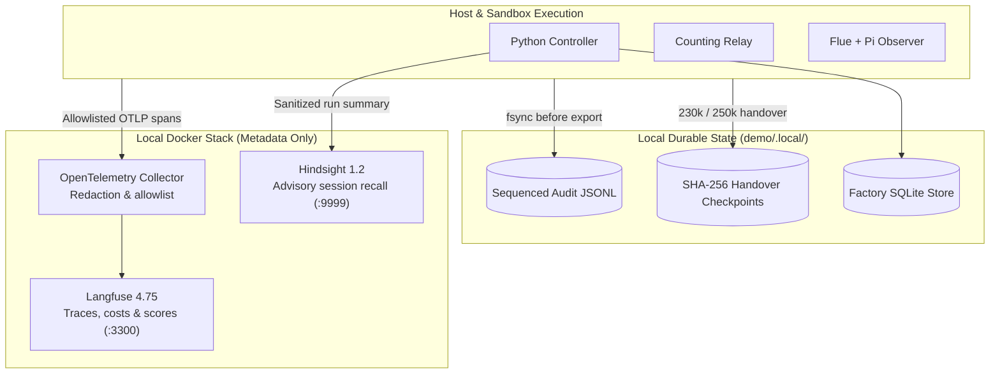

# Architecture Overview

These diagrams show how the Feature Cockpit (`/`), Model Lab (`/lab`), Flue + Pi agent harness, OpenShell sandboxes, and telemetry pipeline fit together. Full component specifications live in [`knowledge/index.md`](../../knowledge/index.md).

## End-to-end feature build flow

## Telemetry and continuity pipeline

## Key boundaries

OpenShell sandboxes run with `--network none`, no host home mount, no Docker socket, and no provider keys. Model requests leave only from the host through the counting relay.

Candidate code runs inside a fresh, network-isolated container whose test suite the author agent cannot inspect or modify.

Before spans reach Langfuse, the OpenTelemetry collector drops prompts, source code, tool payloads, and hidden reasoning so only timing, token counts, and event metadata leave the host harness.
