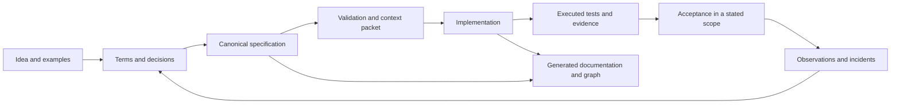

# AxiomSpec

Augmented specifications with explicit models, bounded constraints and traceable verification.

**Edition 0.3.0 · final review, 9 November 2026**  
Specification format: `axiomspec/0.1` · Profile: `AX-CORE-0.1` · Report format: `axiomspec-report/0.2`.

This package defines a local requirements workflow and the contracts for an implementation. It includes schemas, a worked example, reference observations and package QA. The product CLI, graph engine and application test adapters remain to be built.

An augmented specification connects an intended outcome to defined terms, requirements, constraints, scenarios, implementation bindings and evidence. It records uncertainty and decisions explicitly. Deterministic checks make declared properties reproducible; they do not establish that the chosen requirements are complete or correct for the business.

## Workflow

## Design choices

- One editable `spec.json` per product. Product documentation and graphs are derived views.
- A deterministic local core. No model API, server, graph database or agent orchestrator is required.
- A small proposed constraint representation, BCIR. Existing qualified modeling tools may be reused instead.
- Typed relationships and explicit provenance. A declared implementation link is not proof of behavior.
- Bounded queries and mandatory context closure. Required rules are never silently removed to fit a response budget.
- Evidence tied to specification, source, policy, tool and observation revisions.

## Reading guide

| Task | Documents |
|---|---|
| Build the tool | [Implementation handoff](docs/00_IMPLEMENTATION_HANDOFF.md), [incremental plan](docs/12_IMPLEMENTATION_PLAN.md) |
| Understand the basis | [Foundations and references](docs/01_FOUNDATIONS.md), [principles](docs/02_PRINCIPLES_AND_SCOPE.md) |
| Write a product specification | [Authoring workflow](docs/04_AUTHORING_WORKFLOW.md), [templates](docs/15_TEMPLATES_AND_PROMPTS.md) |
| Implement validation | [Canonical model](docs/03_CANONICAL_MODEL.md), [constraint semantics](docs/05_CONSTRAINTS_AND_SEMANTICS.md), [gates](docs/06_GATES_AND_EVIDENCE.md) |
| Retrieve coding context | [Graph and queries](docs/07_KNOWLEDGE_GRAPH_AND_QUERIES.md), [agent contract](docs/08_AGENT_CODING_CONTRACT.md), [context admission](docs/17_CONTEXT_DOMAIN_INTERFACE.md) |
| Verify and maintain behavior | [Testing](docs/09_TEST_STRATEGY_AND_CLOSED_LOOP.md), [change control](docs/10_LIFECYCLE_AND_CHANGE_CONTROL.md), [risk and extensions](docs/11_RISK_SECURITY_AND_EXTENSIONS.md) |
| Inspect an example | [Ledger walkthrough](docs/13_REFUND_LEDGER_WALKTHROUGH.md), [canonical data](examples/refund-ledger/spec.json) |
| Declare execution mode | [Task execution and decision policy](docs/08_AGENT_CODING_CONTRACT.md) |
| Prepare CROA inputs | [Optional readiness profile](docs/18_CROA_READINESS.md) |
| Assess the package | [Conformance corpus](docs/14_CONFORMANCE_SUITE.md), [acceptance limits](docs/16_ACCEPTANCE_AND_LIMITS.md), [review](REVIEW.md), [validation](VALIDATION.md) |

The [rule index](RULE_INDEX.md) links all normative `AX-*` rules. Schemas define structure; the contracts define additional semantics. Resolve a disagreement between a schema, contract and fixture explicitly before shipping an implementation.

The ledger is fictional. Its formulas have reference checks; its application tests are planned. It is not `design_ready`. See the review for the remaining scenario and performance gaps.

Replay package verification with `python3 qa/run_checks.py` after installing [QA dependencies](qa/requirements-qa.txt). The [assurance matrix](review/ASSURANCE_MATRIX.md) separates declared contracts, implemented package checks and unimplemented product capabilities.

Start with the handoff and the contracts for the increment being implemented. Do not load this entire package into every coding session.
