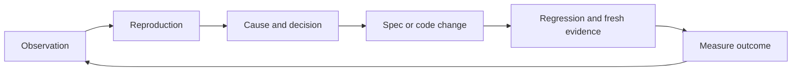

# Tests and feedback

Test three different subjects: the framework implementation, the specifications it receives and the products built from those specifications. Package QA is narrower than all three product claims.

### AX-T-001 — Explicit oracle

State the observation, expected output/property, conditions and limits. Derive the oracle from requirements and decisions rather than candidate implementation output. Useful assertions include unchanged persistent state after refusal, conservation, no duplicate row after retry and denial before private data disclosure.

Use review criteria, competent role, available evidence and disagreement handling for judgment-based obligations. Do not relabel them deterministic tests.

### AX-T-002 — Oracle provenance

Record whether expectations come from a business decision, incident, supplied example, independent calculation or synthetic proposal. Code and tests sharing an incorrect assumption do not confirm each other. Independent review reduces some correlated errors without guaranteeing correctness.

## Verification levels

| Level | Question | Limit |
|---|---|---|
| unit | Isolated rule/function behavior | Mocks do not validate storage |
| property | Property over generated data | Domain, seed and case count bound the result |
| model | Model property in a stated abstraction | Not code equivalence |
| contract | Interface compatibility | Versions and external capabilities matter |
| integration | Real components together | State the actual environment |
| e2e | A complete declared path | A path does not cover every combination |
| manual | Qualified judgment against criteria | Identity, evidence and date matter |

Choose levels by risk. Documentation-only edits usually need artifact checks; concurrency changes need real transaction tests.

### AX-T-003 — Boundaries and unknowns

Cover relevant empty, singleton, duplicate, minimum, maximum, overflow, invalid type, unauthorized actor, missing-data and stale-result cases. Missing data remain unknown. Assert diagnostic subject and kind, not merely that some exception occurred.

A witness may show a correct refusal. A counterexample intentionally violates a property; detecting it passes the reference test, not the business state.

### AX-T-004 — Explicit concurrency and recovery

Use controlled barriers or injection points to force the dangerous interleaving; avoid sleeps as synchronization. For two reservations of 600 against 1,000, verify at most one is admitted and persistent consumption remains within capacity using the actual qualified storage mechanism.

Distinguish same-key/same-payload retry, conflicting payload, in-progress operation, response loss after persistence, cancellation and tenant scope. Define key retention and recovery. A timeout does not establish absence of a server-side effect; an idempotency key does not establish exactly-once delivery.

For failure tests, identify crash point, durable writes, acknowledgment and recovery procedure.

## Test effectiveness

Try representative mutations: `<` instead of `<=`, omitted reservations, removed tenant checks, duplicate keys and stale digests. Investigate surviving mutants: insufficient oracle, equivalent mutation or out-of-scope behavior. Line coverage is execution coverage, not correctness.

### AX-T-005 — Planned, implemented and executed

TestCase state describes an artifact. It is never an execution result. Receipts identify actual collected test IDs and detect missing, duplicate or skipped tests. A zero exit status with zero collected tests cannot satisfy a nonempty plan.

### AX-T-006 — Incident to revision

Keep the initial observation, bounded reproduction, confirmed cause, remaining hypotheses and decision. Classify code defect, incorrect need, external contract, configuration or missing instrumentation before changing rules. Retain historical expectations and results; do not rewrite them to make an old release appear compliant.

## Operational feedback

Process traces need correlation keys, clock semantics, loss estimates and a collection window. Partial traces can support several explanations. Statistical process discovery or a model suggestion is a lead, not an automatically authorized transition.

Measure clarification effort, useful defects, context omissions, maintenance cost and query latency against a defined baseline. Keep failures. Do not claim productivity or scale gains from this example alone.
