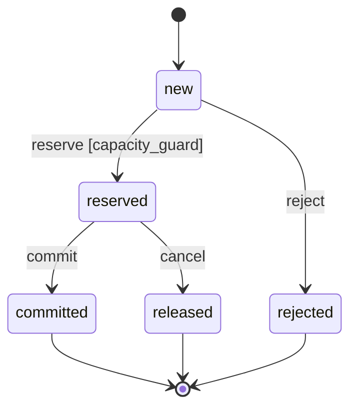

# Reference ledger

The [canonical example](../examples/refund-ledger/spec.json) models a fictional local refund ledger per tenant/payment. It has no real money, banking provider, credentials or network effects. Test bindings are planned paths, not existing application code.

## Decisions and vocabulary

Reserved and committed amounts consume captured capacity. Cancellation releases capacity but retains the idempotency key. Same key and payload returns the existing result; conflicting payload is refused. Keys are scoped to tenant/payment and retained for the example ledger's lifetime.

Amounts are safe integer euro cents in this example. A real product must explicitly decide durability, purge, availability and provider integration. Observation bounds do not prove behavior beyond the modeled data.

`auth.verified` is a projection from an authentication adapter to build. A client-supplied Boolean is not authentication. The reference evaluator tests the predicate, not the adapter's trustworthiness.

## Requirements

| ID | Behavior | Application verification still to implement |
|---|---|---|
| REQ-001 | Refuse over-capacity reservation without mutation | Boundaries and real transaction concurrency |
| REQ-002 | Same key/payload retrieves the prior result | Retry after lost response; no extra row |
| REQ-003 | Same key/different payload is refused | Persistent state unchanged |
| REQ-004 | Deny unauthorized tenant access | Refuse before disclosure/mutation |
| REQ-005 | Cancel reservation and release capacity | Transition, retained key and repeated cancellation |
| REQ-006 | Commit without double consumption | Durable transition and preserved sum |
| REQ-007 | Bounded audit without secrets/raw payload | Event inspection and sensitive-data tests |

All 14 TestCases are planned. Four normal-path markers and two overly broad verification links were corrected during review. Missing behavioral scenarios remain visible rather than being replaced by extra links.

## Predicates

| ID | Role | Property |
|---|---|---|
| CON-001 | invariant | Reserved plus committed total <= captured capacity |
| CON-002 | admission_guard | Positive request and sufficient remaining capacity |
| CON-003 | invariant | Existing rows have positive amounts |
| CON-004 | invariant | Each key occurs at most once in the observed ledger |
| CON-005 | admission_guard | Verified principal, request and resource tenants agree |
| CON-006 | review | Diagnostic clarity under a review protocol |

Snapshot uniqueness does not establish temporal idempotence. A false guard can represent a correct refusal, while a false invariant identifies an invalid state.

## State view

The model references effects but does not define executable transition transformations. This explanatory view is not an exhaustive concurrent-state proof.

## Reference observations

[observations.json](../examples/refund-ledger/observations.json) contains nine synthetic observations, each with five Boolean expectations.

| Scenario | Case | Expected distinction |
|---|---|---|
| SCN-001 | 600 reserved + 400 committed against 1,000; another request | Valid state, admission refused |
| SCN-002 | 600 + 401 against 1,000 | Capacity violation detected |
| SCN-003 | Empty ledger, request 400 | Admission possible; collection invariants are vacuous |
| SCN-004 | Zero row and zero request | Positivity violated; admission refused |
| SCN-005 | Duplicate key | Uniqueness violation |
| SCN-006 | Wrong request tenant | Authorization guard false |
| SCN-007 | 700 released, 400 committed, request 600 | Released amount no longer consumes capacity |
| SCN-008 | Unverified principal | Authorization guard false |
| SCN-009 | Principal/request agree but resource tenant differs | Resource ownership must also be checked |

## Implementation gaps

Two requests of 600 may each satisfy a guard against the same initial capacity of 1,000. Without atomic admission, their writes overbook. CTRL-001 therefore requires a persistent atomic boundary and forced-interleaving integration tests. The formula alone does not implement that boundary.

The example lacks a linked authorized-access scenario and complete behavioral retry, invalid-transition and crash-recovery cases. G07 is not satisfied; the example is not design_ready. G10 has no executed application evidence.

CON-004 is quadratic and exceeds the reference step budget at 500 rows although the schema admits 1,000. Qualify a more efficient realization before claiming full-bound coverage.

For a cancellation change, retrieve REQ-005, terms, applicable constraints, MODEL-001, tests and bindings, including project-level capacity and authorization rules. Inspect actual code when it exists. Unmodeled key purging is an unmapped change, not proof of no impact.

The optional execution declaration and CROA sidecar demonstrate metadata shape and unknown handling. They add no deployed authority or CROA conformance to this ledger.
