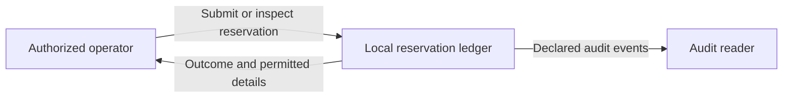
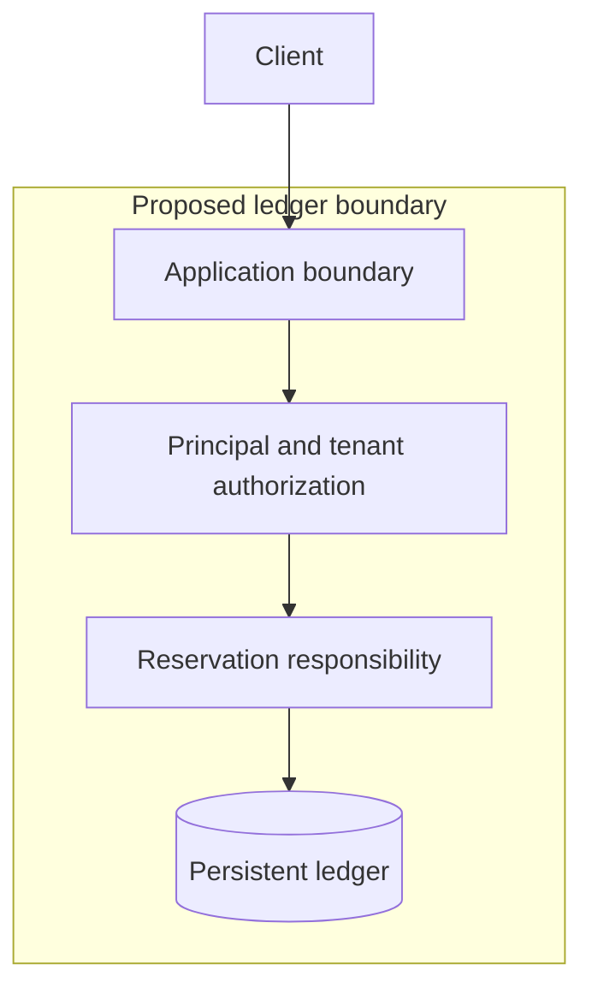
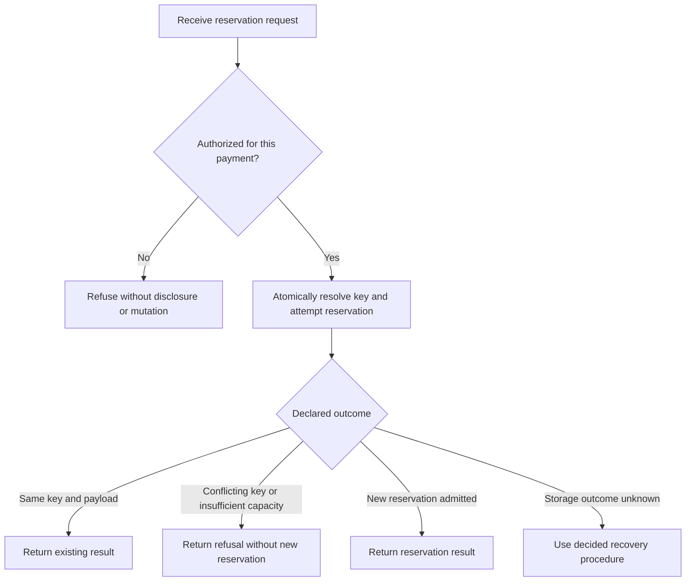
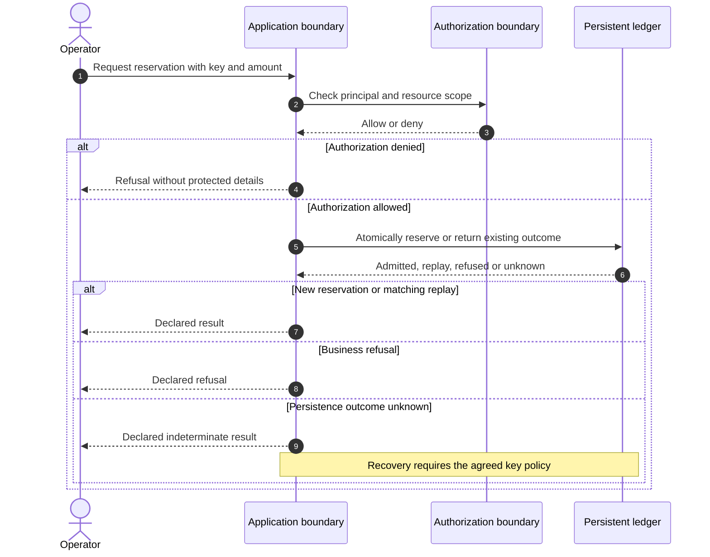
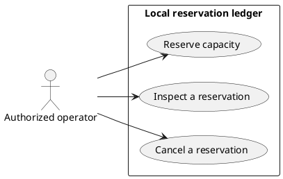

# New project: AxiomSpec and a human documentation cockpit

Version 1.0 · 9 November 2026 · Companion to AxiomSpec edition 0.3.0.

## Contents

- [Purpose and current capabilities](#1-purpose-and-operating-boundary)
- [Ownership and repository layout](#3-keep-authority-and-ownership-explicit)
- [From idea to canonical draft](#5-capture-the-idea-before-choosing-architecture)
- [Cockpit and navigation](#10-design-the-cockpit-around-questions)
- [Diagram families and source conventions](#12-separate-diagram-sources-from-formal-model-claims)
- [Generation and human decisions](#18-a-small-view-catalog-and-regeneration-contract)
- [Implementation and verification](#20-implementation-and-verification-sequence)
- [Instruction for an authoring agent](#22-ready-to-use-instruction-for-an-authoring-agent)

## 1. Purpose and operating boundary

Use this playbook to turn a new product idea into an explicit specification, a useful human documentation cockpit, and a small implementation with meaningful tests. A human or an AI can perform authoring work. Decisions about business meaning remain with the project's authorized decision-makers.

The requested deliverables are two connected outputs:

1. **The AxiomSpec specification:** goals, terms, requirements, decisions, constraints, state models, scenarios, test plans and implementation bindings.
2. **The human cockpit:** a navigable Markdown entry point, readable specification pages, a system overview, process diagrams, sequence diagrams and use-case diagrams.

The cockpit is a documentation layer. It does not extend the AxiomSpec schema or create another requirements authority. This playbook defines a proposed project workflow, not new normative `AX-*` rules.

**Current implementation limit:** the supplied AxiomSpec package contains contracts, schemas, reference material and package QA. Its product CLI, complete static compiler, graph/query engine and application test adapters are not implemented. Commands named `axiom` in that package are proposed interfaces. Neither this guide nor a generated cockpit makes them executable.

The workflow can start with manual or AI-assisted authoring and an ordinary Markdown viewer. Automation should be added in small verified increments. Never describe a planned generator, test or graph query as executed.

## 2. Read the applicable contracts

Use the supplied package rather than reconstructing its schema from this guide:

| Need | Source |
|---|---|
| Actual capabilities and limits | [README](../AxiomSpec/README.md), [assurance matrix](../AxiomSpec/review/ASSURANCE_MATRIX.md) |
| Authoring and canonical fields | [Workflow](../AxiomSpec/docs/04_AUTHORING_WORKFLOW.md), [model](../AxiomSpec/docs/03_CANONICAL_MODEL.md), [schema](../AxiomSpec/schemas/spec.schema.json) |
| Constraint meaning and bounds | [Constraint semantics](../AxiomSpec/docs/05_CONSTRAINTS_AND_SEMANTICS.md) |
| Gates and evidence | [Gates](../AxiomSpec/docs/06_GATES_AND_EVIDENCE.md), [tests](../AxiomSpec/docs/09_TEST_STRATEGY_AND_CLOSED_LOOP.md) |
| Agent context and changes | [Graph](../AxiomSpec/docs/07_KNOWLEDGE_GRAPH_AND_QUERIES.md), [agent contract](../AxiomSpec/docs/08_AGENT_CODING_CONTRACT.md), [context admission](../AxiomSpec/docs/17_CONTEXT_DOMAIN_INTERFACE.md) |
| Building missing capabilities | [Implementation handoff](../AxiomSpec/docs/00_IMPLEMENTATION_HANDOFF.md), [incremental plan](../AxiomSpec/docs/12_IMPLEMENTATION_PLAN.md) |

When moving this guide elsewhere, provide the AxiomSpec package and repair these relative links. A standalone guide does not replace the schema or authorize external actions.

## 3. Keep authority and ownership explicit

| Artifact | Editable source | Purpose and authority |
|---|---|---|
| Product specification | `spec/spec.json` | Canonical requirements, definitions, decisions and declared traceability |
| Original brief and supplied material | `docs/authored/` or admitted source storage | Preserve the initial need and its provenance |
| Architecture notes | `docs/authored/architecture.md` | Proposed or observed structure not fully represented in the core model |
| Diagram sources | `docs/diagrams/source/` | Human documentation views, with explicit references and scope |
| View catalog | `docs/view-catalog.json` | Documentation metadata only; no competing requirement statements |
| Generated pages and rendered images | `docs/generated/`, `docs/diagrams/rendered/` | Disposable reading views derived from identified inputs |
| Business review records | `spec/reviews/` | Evidence for decisions; not a second editable decision register |
| Task packets and test receipts | `spec/changes/`, `spec/evidence/` | Scoped work, execution facts and remaining limits |
| Cockpit | `docs/README.md` | Navigation and an honest summary of those artifacts |

Canonical node status `active` means applicable in the model. It does not authenticate approval. A review record needs the actual decision, scope, reviewer role and source; identity requirements depend on policy.

Human documentation must not silently add an obligation, permission, state transition or acceptance criterion. Put that proposed change into the canonical specification and its decision process first. Architecture details can remain documentation facts, but any behavior they prescribe must have a requirement or explicit decision behind it.

## 4. Start with the smallest useful repository layout

This is a proposed target-product layout. It does not describe files already delivered with AxiomSpec. Adapt to a real repository's conventions rather than creating duplicate structures.

```text
project/
  spec/
    spec.json
    changes/
      CHG-001.md
    reviews/
    evidence/
  docs/
    README.md
    view-catalog.json
    authored/
      brief.md
      architecture.md
    diagrams/
      source/
        01-system-context.mmd
        02-system-components.mmd
        03-main-process.mmd
        04-main-sequence.mmd
        05-use-cases.puml
      rendered/
    generated/
      product/
      system/
      processes/
      sequences/
      use-cases/
      verification/
  src/                       # adapt to the chosen stack
  tests/                     # adapt to the chosen stack
```

Create directories when they receive real content. Begin with one cockpit and one useful view per requested diagram family. Add more views for a new audience or a distinct question, not to increase document count.

A static Markdown cockpit is the default. A local HTML viewer may be added if navigation or rendering warrants it. Do not introduce a database, authentication service, orchestration platform or web framework just to browse this material.

## 5. Capture the idea before choosing architecture

Write the brief in plain English. Preserve user-supplied wording as a source and distinguish it from interpretations added by the author.

```text
Working name:
User and concrete situation:
Observed problem:
Desired observable outcome:
Two examples of success:
One example of correct refusal:
First scope:
Explicit exclusions:
Data, external systems and actors:
Most costly plausible failure:
Business decision owner:
Known facts:
Proposals:
Unknowns that affect behavior or rights:
```

Do not infer a payment provider, cloud platform, queue, tenant model or autonomous agent platform from a generic product idea. Record a candidate choice when useful, with its reason and consequences. Continue independent work while a material decision is pending.

For a fictional local refund ledger, the first scope might be reserving capacity for one payment and refusing an excessive request. Actual fund movement and external provider integration would be separate scope, not capabilities implied by a diagram.

## 6. Establish the vocabulary and decisions

Define domain terms before relying on them in formulas or tests. For each important term, explain context, meaning, representation, unit, unknown values and examples. The core `Term` supports definition, aliases, unit and context; put supporting examples in admitted sources or reading views. Do not invent extra fields inside the closed canonical schema.

For the ledger, clarify at least:

- whether amounts use minor currency units and which currency is in scope;
- what captured capacity means;
- which statuses consume that capacity;
- when a reservation is acquired and released;
- the identity and scope of an idempotency key;
- who may request, commit or cancel a reservation.

An unanswered question that changes behavior becomes a canonical `Decision`. Keep its answer null until an authorized answer exists. An AI may recommend an option and continue drafting unaffected material. It must not attribute acceptance to a person who has not accepted it.

Human review should show the proposed meaning, its source, examples, counterexamples and the consequence of choosing another meaning. A large undifferentiated approval screen is not an effective review interface.

## 7. Produce a small canonical draft

Use `axiomspec/0.1` and `AX-CORE-0.1` unless the actual supplied package says otherwise. Stable IDs survive renames. Sources preserve where an assertion came from. Render requirement sentences from structured fields; do not add another editable `statement`.

The following is a complete **structural draft example**, not a ready product specification. It is fictional, in `example` mode, with draft nodes, an unresolved decision, no executable constraint, no scenarios and no tests. Do not promote it by changing flags. Replace its fixture source with actual product sources when authoring a real project.

```json
{
  "format": "axiomspec/0.1",
  "profile": "AX-CORE-0.1",
  "project": {
    "id": "PROJECT-001",
    "name": "Local reservation ledger draft",
    "description": "Fictional authoring starter without external money movement.",
    "owner": "ACTOR-001",
    "mode": "example"
  },
  "actors": [
    {
      "id": "ACTOR-001",
      "name": "Example business-owner role",
      "type": "human_role",
      "binding_status": "asserted"
    }
  ],
  "sources": [
    {
      "id": "SRC-001",
      "type": "fixture",
      "locator": "fixture:new-project-playbook/1.0",
      "capture_sha256": null,
      "review_state": "fixture"
    }
  ],
  "environments": [],
  "nodes": [
    {
      "id": "GOAL-001",
      "kind": "Goal",
      "revision": 1,
      "status": "draft",
      "title": "Preserve captured capacity",
      "owner": "ACTOR-001",
      "created_by": "ACTOR-001",
      "source_ids": ["SRC-001"],
      "data": {
        "description": "Reserve only capacity available for a payment.",
        "success_measure": "The accepted capacity rule holds in the defined scope."
      }
    },
    {
      "id": "TERM-001",
      "kind": "Term",
      "revision": 1,
      "status": "draft",
      "title": "Captured capacity",
      "owner": "ACTOR-001",
      "created_by": "ACTOR-001",
      "source_ids": ["SRC-001"],
      "data": {
        "definition": "Capacity recorded for one payment; representation is pending DEC-001.",
        "aliases": [],
        "unit": null,
        "context": "Fictional local ledger"
      }
    },
    {
      "id": "REQ-001",
      "kind": "Requirement",
      "revision": 1,
      "status": "draft",
      "title": "Refuse an over-capacity reservation",
      "owner": "ACTOR-001",
      "created_by": "ACTOR-001",
      "source_ids": ["SRC-001"],
      "data": {
        "category": "functional",
        "priority": "must",
        "risk": "high",
        "verification_mode": "executable",
        "pattern": "unwanted",
        "conditions": [],
        "trigger": "a reservation request would exceed the available captured capacity",
        "feature": null,
        "subject": "ledger",
        "response": "refuse the request without changing persistent ledger state"
      }
    },
    {
      "id": "DEC-001",
      "kind": "Decision",
      "revision": 1,
      "status": "draft",
      "title": "Choose the amount representation",
      "owner": "ACTOR-001",
      "created_by": "ACTOR-001",
      "source_ids": ["SRC-001"],
      "data": {
        "question": "Which currency and amount representation apply to the first slice?",
        "options": ["Integer EUR cents", "Another explicitly defined representation"],
        "answer": null,
        "blocking": true,
        "rationale": "Capacity comparisons require an agreed representation and compatible units."
      }
    }
  ],
  "edges": [
    {
      "id": "EDGE-001",
      "from": "REQ-001",
      "relation": "satisfies",
      "to": "GOAL-001",
      "origin": "declared",
      "rationale": "Refusal prevents this request from exceeding capacity."
    },
    {
      "id": "EDGE-002",
      "from": "REQ-001",
      "relation": "uses_term",
      "to": "TERM-001",
      "origin": "declared",
      "rationale": "The request is evaluated against captured capacity."
    },
    {
      "id": "EDGE-003",
      "from": "DEC-001",
      "relation": "governs",
      "to": "REQ-001",
      "origin": "declared",
      "rationale": "The amount decision changes the requirement's formal interpretation."
    }
  ],
  "bindings": [],
  "context_assets": []
}
```

The `executable` verification mode is an intended method, not evidence that a test exists. This draft cannot satisfy product readiness gates. The [worked ledger](../AxiomSpec/docs/13_REFUND_LEDGER_WALKTHROUGH.md) is a richer reference and also has explicit remaining gaps.

## 8. Formalize only useful, defined properties

After the meaning is decided, express the selected property in a supported representation. AxiomSpec's proposed BCIR is a bounded AST with explicit types, units and work limits. It is not arbitrary executable text, a complete OCL implementation or an automatic translator from prose.

For the ledger, an intended invariant could be:

```text
For one tenant/payment and one defined currency:
sum(amount_minor for rows with status reserved or committed)
    <= captured_minor
```

This is explanatory notation, not BCIR JSON. Use the supplied constraint contract and example to author the actual expression and environment. Preserve duplicates in sums. Do not treat missing observations as an empty collection.

Distinguish an invariant from an admission guard. Two concurrent requests can each satisfy a guard against the same initial state. Correctness also requires an actual atomic enforcement boundary and a test that forces the dangerous interleaving.

If a property requires human judgment, use a review protocol with criteria. If a required compiler, solver or adapter is absent, report that capability as missing. Do not invent operators, hide code in prose fields or substitute a model's approval for a deterministic result.

## 9. Define scenarios and oracles before implementation

Choose expectations from the accepted requirement and decision, not by copying the candidate implementation's output.

| Case | Expected observation |
|---|---|
| Request fits available capacity | One admissible reservation and the declared response |
| Request exceeds capacity | Refusal and no persistent mutation |
| Two requests of 600 against capacity 1,000 | At most one new reservation is admitted |
| Same key and payload retried | The agreed prior result is returned without another reservation |
| Same key with a different payload | Explicit refusal under the decided key policy |
| Unauthorized tenant | No disclosure or mutation before refusal |
| Response lost after persistence | Recovery follows the decided retry behavior |

These are candidate cases for the fictional domain. They become product expectations only after the applicable decisions are made. Specify exact observations, response contracts, durable state and environment. A vague sentence about a failure is not a complete test oracle.

Connect `Scenario` and `TestCase` objects using valid typed edges. Keep a test's planned/implemented state separate from its actual execution receipt. Use unit tests for isolated calculations, integration tests for storage and concurrency, and E2E tests for a defined complete path. A mocked database cannot establish transaction safety.

## 10. Design the cockpit around questions

The cockpit should help a person answer:

1. What is this product for, and what is outside its scope?
2. What are its main actors, boundaries and dependencies?
3. Which use cases and processes matter?
4. What do important terms and rules mean?
5. Which decisions remain open, and who can resolve them?
6. Which tests have actually run on which inputs?
7. What changed, and which documents or evidence are stale?

Use descriptive titles, stable IDs, short summaries and local links. Keep business explanations readable without requiring the reader to interpret JSON. Show pending decisions before detailed technical pages. An unexecuted check is `unknown`, not a green badge.

A useful status table separates subjects:

| Subject | Honest display |
|---|---|
| Artifact structure | Actual schema/check result, or not checked |
| Business decisions | Answered/open with references |
| Formal semantics | Exercised subset and missing capability |
| Diagram source | Present, missing or stale |
| Diagram rendering | Rendered with version, failed or not rendered |
| Product tests | Executed results, environment and stale/missing evidence |
| Operational behavior | Observed window or not observed |

Do not calculate a single “quality score” from document count, diagram count or percentage of populated fields. A dashboard is not a release authorization.

## 11. Cockpit template

The following is a **target-project page template**. Its links refer to the proposed target layout and are not links to files delivered by this playbook. Emit only working links or explicitly marked missing items in a real cockpit.

````markdown
# Product cockpit

Scope: <one-sentence boundary>
Specification baseline: <actual digest or not captured>
Source snapshot: <actual digest or not captured>
Documentation build: <actual build reference or manual draft>

## Start here

- [Intent and scope](generated/product/overview.md)
- [Terms and requirements](generated/product/requirements.md)
- [System context](generated/system/context.md)
- [System components](generated/system/components.md)
- [Main process](generated/processes/main.md)
- [Main sequence](generated/sequences/main.md)
- [Use cases](generated/use-cases/index.md)
- [Verification](generated/verification/index.md)

## Decisions needing attention

| Decision | Consequence | Responsible role | State |
|---|---|---|---|
| <DEC-ID> | <affected behavior> | <actual role> | <open/answered> |

## Evidence and limits

| Subject | Result | Input baseline | Evidence |
|---|---|---|---|
| <actual check> | <pass/fail/unknown/error> | <digest> | <local receipt> |

## Recent changes

<Link the actual change record, affected IDs, stale views and next action.>
````

Generated requirement pages must carry canonical IDs and rendered wording. Decision lists must be derived from canonical decisions. Do not maintain parallel editable copies of definitions, requirements or decision answers in cockpit tables.

## 12. Separate diagram sources from formal model claims

The four requested diagram families are human documentation views. Use text sources in the repository so reviewers can see changes. Mermaid flowcharts suit system overviews and process maps; Mermaid sequence diagrams suit interactions; PlantUML provides conventional UML use-case notation. [Mermaid flowcharts](https://mermaid.js.org/syntax/flowchart.html), [sequence diagrams](https://mermaid.js.org/syntax/sequenceDiagram.html), [PlantUML use cases](https://plantuml.com/use-case-diagram).

Pin and record the chosen local renderer versions when implementing the documentation build. Some Markdown viewers render Mermaid but not PlantUML. For those viewers, render PlantUML locally to SVG or PNG and link both image and source. Do not silently substitute a flowchart and call it UML.

AxiomSpec does not contain every architecture fact, use-case association or ordered message needed for these views. Record the additional facts in reviewed architecture/diagram sources. AI may draft those sources; draft generation is not deterministic semantic derivation. Once sources are fixed, rendering can be automated. Layout is not assumed pixel-identical across engines or environments.

Each real view should identify:

```text
View ID and title:
Question answered and audience:
Claim: proposed / intended / observed
Canonical IDs actually referenced:
Additional architecture or interaction sources:
Source baseline and specification baseline:
Scope and omitted details:
Review state and relevant decision references:
Renderer and output reference, if rendered:
```

Those labels belong to documentation metadata, not new canonical node fields. “Observed” requires stated code or runtime evidence; “intended” describes an accepted target; “proposed” is an unaccepted design. Missing evidence must not be filled by an attractive diagram.

## 13. System views: context and components

Produce a context diagram showing the product boundary, external actors and external systems. A second diagram may show main internal responsibilities and stores. Do not mix deployment topology with business responsibilities unless the audience needs both.

The diagrams below are fictional **proposals** for an expanded ledger design. They are not derived outputs of the minimal draft in section 7. Their components and actors must be declared or sourced before use in a real project.

System context:



System components:



The store box does not select a database or prove durability. The authorization box does not implement access control. Explain the decision and verification needed behind each boundary. Keep external payment providers absent when fund movement is outside scope.

For each meaningful internal box, link its actual canonical Component if one exists. Relationships not supported by the core edge registry stay explicitly documented architecture facts. Do not create unsupported edge types inside `spec.json`.

## 14. Process views: decisions and outcomes

A process map describes activity order, branches, responsible boundaries and failure/refusal paths. Start with a simple flowchart. If formal BPMN semantics are needed, select a real BPMN model and tool explicitly; a flowchart does not become executable BPMN by its title.

Candidate reservation process:



The atomic activity is an obligation on a future implementation. It is not a proof that a particular transaction realizes it. The recovery branch requires a real decision and oracle. Do not invent a retry policy merely to close the diagram.

In the generated page, associate branches with the relevant actual requirements, decisions and scenarios. Preserve unknown branches visibly. Never deduce an allowed transition solely from the fact that a database happens to contain two status values.

## 15. Sequence views: interactions and failure boundaries

A sequence diagram shows participant order and alternatives. Include the principal boundary, persistent mutation, acknowledgment and important failure points. Distinguish synchronous calls, asynchronous messages and inferred interactions.

Candidate main sequence:



Business owners must decide externally visible response semantics; transport codes are not chosen here. Add a separate sequence for a lost response after persistence or concurrent admission when it materially clarifies the requirement. Avoid an unreadable single sequence containing every scenario.

An intended sequence does not establish an observed trace. A trace needs correlation, timing and coverage evidence before it can be shown as actual behavior.

## 16. Use-case views: actors and capabilities

Use-case diagrams show who can pursue which goals across the system boundary. They do not specify execution order or detailed authorization. Keep a short textual page for each important use case with actor, goal, preconditions, main outcome, refusal paths and linked requirement/scenario IDs.

Candidate use-case diagram in PlantUML:



These are proposed capabilities, not permission grants. Define the actual actors and rights in the specification and enforcement policy. Avoid decorating every diagram with `include` or `extend`; use those relationships only with a deliberate UML meaning. A separate authorization diagram is unnecessary if a concise rights table and refusal tests answer the question.

`VIEW-*`, `PROC-*`, `SEQ-*` and `UC-*` identifiers, if used, are local documentation identifiers. They are not additional AxiomSpec canonical kinds. Map them to existing canonical IDs through documentation metadata.

## 17. Optional state and domain views

A state view can mirror a real canonical StateModel, preserving states, transition IDs, events and guard references. A domain/class view can explain terms and relationships from defined sources. Neither substitutes for an executable environment, predicate or transition effect.

For example, a ledger may have reserved, committed and released states. Whether committed can later be cancelled is a business decision; do not add the arrow because a drawing looks more complete. If an effect is descriptive rather than executable, say so and do not advertise exhaustive state exploration.

Generate the views that answer actual review questions. The requested four diagram families remain part of the cockpit; additional families are optional.

## 18. A small view catalog and regeneration contract

A project can use the following **proposed documentation-only convention**. It is not an AxiomSpec profile, shipped API or standard. Paths are repository-relative and the referenced files must exist before a build can claim success.

```json
{
  "format": "project-doc-views/0.1",
  "views": [
    {
      "id": "VIEW-PROCESS-001",
      "kind": "process",
      "title": "Reservation process",
      "claim": "proposed",
      "canonical_ids": ["REQ-001", "DEC-001"],
      "source_path": "docs/diagrams/source/03-main-process.mmd",
      "page_path": "docs/generated/processes/main.md",
      "scope": "One request path; recovery policy is unresolved"
    }
  ]
}
```

Keep only metadata here. Requirements and decision answers come from `spec.json`; authored architecture facts remain in their source. A generation receipt should separately identify actual input byte digests, the canonical specification digest when available, generator/renderer versions, outputs and limitations. Do not invent a canonical digest with a convenient serializer that disagrees with the AxiomSpec digest contract.

When automating documentation generation:

1. Read a fixed admitted input snapshot and verify references.
2. Derive canonical text from structured fields using ordinary code and templates.
3. Combine only identified editorial sources for additional view details.
4. Escape values for Markdown, diagram labels and links. Treat requirement text as data, never as a diagram directive.
5. Render locally with pinned tools. Keep unsupported renderers explicit.
6. Check working navigation, referenced IDs, output inventory and stale inputs.
7. Publish a complete new generated view set; retain the last complete set if generation fails.

For an initial single-writer manual workflow, a reviewed edit and a short generation note are enough. Do not build an elaborate publishing service. If a manifest-based generator is added, generated output and evidence must not be inputs to their own digest calculations.

## 19. Automation and human review boundaries

| Work | Default treatment |
|---|---|
| Draft a brief, terms, questions and views | Human or AI authoring, labeled as proposals |
| Validate shape, references, supported calculations and stale inputs | Deterministic automation when the capability exists |
| Decide business meaning, rights or material trade-offs | Authorized decision-maker, with recorded consequences |
| Implement routine work within an accepted task | Delegated execution under actual scope and policy |
| Accept product behavior | Actual required checks and authority, not document presence |

Do not require renewed approval of unchanged, previously accepted meaning. Reopen the relevant review when meaning, source interpretation, effective scope or policy changes. Pause the affected dependent work; continue independent authorized work.

If autonomous execution is used, keep the existing execution-mode sidecar and pinned decision policy. Do not add an `autonomous` Boolean to every requirement. Execution cadence does not grant permission to decide business rules or deploy.

## 20. Implementation and verification sequence

Start with one requirement, one important constraint, relevant normal/refusal cases and real code/tests. Inspect the actual chosen stack before prescribing commands or adapters. Planned bindings become resolved only after the declared selectors are found in a stated source snapshot.

Treat validation as distinct subjects:

- specification structure and declared relationships;
- the supported semantics of constraints and models;
- documentation and diagram integrity;
- product behavior in executed tests;
- operation in a stated runtime window, when relevant.

The actual package command `python3 qa/run_checks.py`, run from the AxiomSpec package directory with its QA dependencies, checks that package. It does not validate an arbitrary new product or execute its tests. Use real repository commands discovered from its configuration and record what they exercised.

No phase becomes `design_ready` merely because this guide's checklist is complete. The gate contract requires G01-G07 and the applicable decisions/assumptions. Missing required engine capabilities remain unknown. Test results must match the final specification, source, environment, runner and policy inputs.

## 21. Definition of a useful first delivery

Deliver a reviewable first slice containing:

- a sourced brief and bounded scope;
- a canonical draft with stable IDs and visible decisions;
- precise definitions and a formal property or explicit review protocol;
- concrete normal, refusal and relevant failure/concurrency expectations;
- one system overview, process, sequence and use-case view with claim labels;
- a cockpit with working navigation and honest capability/evidence states;
- real code/tests if implementation was authorized, otherwise an explicit plan;
- actual verification output and remaining gaps.

Check the documentation with broken links, missing IDs, a changed canonical rule, a stale diagram source and an absent renderer. The cockpit should expose these problems rather than preserve an old green summary. These are future build acceptance cases, not tests supplied by this guide.

After an incident, retain the observation, reproduce it in scope, determine whether the problem is code, intent, external contract or missing evidence, and revise the smallest affected requirement/test/view set. Preserve history. Do not rewrite old expectations to make a past result appear compliant.

## 22. Ready-to-use instruction for an authoring agent

```text
Use this playbook with the supplied AxiomSpec package to start a new product.

First inspect the repository, package capabilities, schemas, actual tools and
existing conventions. Do not assume the proposed axiom CLI or graph engine exists.

Capture the idea and its sources. Separate facts, proposals and unknowns. Produce
one canonical spec/spec.json using the supplied schema. Define domain meaning,
units, decisions, atomic requirements, relevant constraints, scenarios and oracles.
Keep material unanswered decisions explicit and continue independent work.

Create a local Markdown cockpit. Include system overview, process, sequence and
use-case documentation. Keep diagram sources in the repository. Distinguish
proposed, intended and observed claims. Additional architecture facts belong in
identified editorial sources; they must not silently change canonical obligations.

Use deterministic templates for canonical reading views when implementing a
generator. AI-drafted diagram content is a proposal until reviewed. Do not extend
the closed AxiomSpec schema to hold documentation-only metadata.

Implement only the authorized small slice. Preserve test oracles, use the actual
repository commands and report executed evidence separately from planned tests.
Do not install unnecessary infrastructure or treat this document as permission
for external connections, publication, deployment or protected business decisions.

Return paths, the specification baseline, open decisions, working cockpit links,
actual checks and results, unsupported capabilities and the next bounded action.
```

## 23. Related workflow

If the domain already has difficult relational data and its meaning needs recovery, use the [existing-project NVIDIA playbook](02_EXISTING_PROJECT_NVIDIA_TO_AXIOMSPEC.md) for temporary discovery. Keep this cockpit and authoring structure as the destination. Do not adopt a second live requirements authority.
