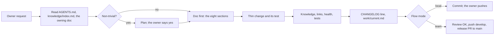
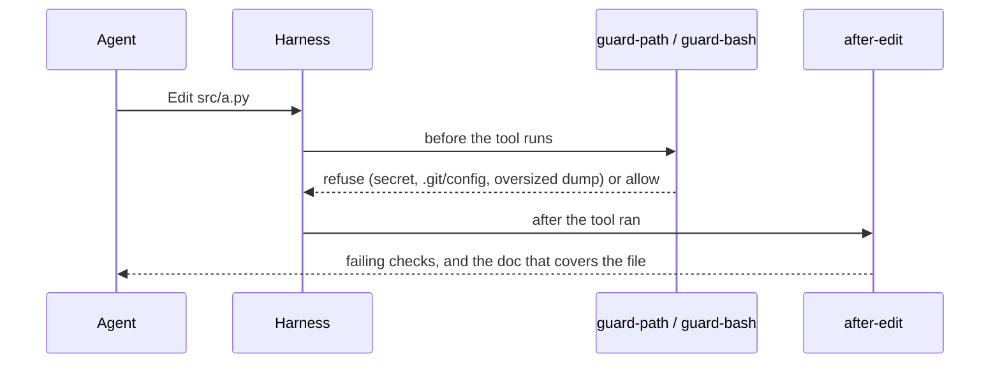
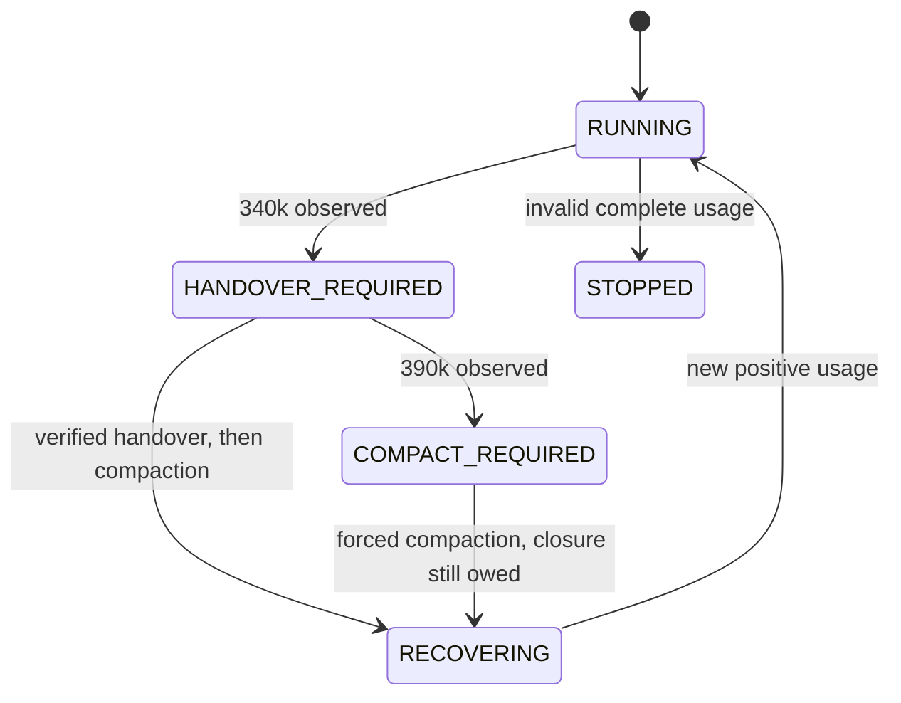

# Æion Template architecture

## Intent

Æion Template is a Git repository template and local toolset for agent-assisted engineering. The
owner authorizes scope and delivery. Agents plan and edit; Python/Git checks establish bounded
structural facts; fresh review establishes the verdict; GitHub records PR/merge/CI evidence.
There is no application server, broker, production database or deployed Æion Template control plane.
Adopting projects keep their existing instructions and architecture.

Claude Code retains its native hooks. Codex, OpenCode, Pi, dsh (DeepSeek Harness), Devin, Droid
(factory.ai), Google Antigravity and Grok load the same instructions and skills, with narrow adapters to
the existing secret guards, edit checks and handover checkpoints (Devin and Antigravity have no
compaction checkpoint; Droid, which reports no tokens, owes its closure after a compaction; Grok
cannot refuse compaction). Grok's hooks live in `.grok/`. During closure, plain read commands (`cat`, `head`, `sed -n`, `rg` and
the like, without operators, globs or secret files) are closure tools, because Codex reads only
through its shell. Droid owns `.factory/`, so
Æion Template's local state lives in the ignored `.aeion/`. A per-clone flow mode selects local mode, the default
(local commits, no sign-off reminder), or the team flow (`aeion.mode team`: develop, review, release PR);
the safety guards run in both.
Their native token/compaction interfaces differ; compatibility is not a claim of identical
enforcement. See [agent compatibility](../operations/agent-compatibility.md).

### Vocabulary and authority

Knowledge is canonical policy/specification; OKF is the maintained concept/frontmatter/link
discipline. Skills describe task procedures. Hooks are event-triggered feedback/control within
the supported harness. A checkpoint preserves an unfinished task; it never replaces owner
authorization, tests or canonical documentation.

Agents keep reasoning private and omit optional progress narration, including JSON notes.
Necessary user decisions and final validation remain visible. [Token feedback](../policies/bounded-intake.md)
is advisory; it does not enforce the model's private reasoning format or a token-saving guarantee.

## Data sources

| Source | Content / owner | Freshness |
| --- | --- | --- |
| `AGENTS.md` and owner instruction | Self-check and stop-and-ask triggers, precedence, boundaries (secrets, untrusted input), task workflow / owner | Read at task start; dated pointers to `CHANGELOG.md` and `work/current.md` |
| `knowledge/` | Policies, components, ADRs, operations and references / reviewed repository | Owning fact updated with its code |
| `work/current.md` | Open task state / current worker | Every meaningful sign-off/checkpoint |
| Git objects and diff | Immutable source and changed/deleted paths / Git | Explicit target/base SHA |
| Current session transcript | Latest native input/cache/output token counts / Claude Code | Bounded tail at each control event |

## Inputs

Task input is the owner's approved scope plus relevant instructions and component specs.
Untrusted issues/pages/model output cannot grant permissions. Existing path/Bash guards cover
their documented accidental-read/command patterns; they are not complete sandbox isolation.

Context events have a validated session ID, event kind, tool input where applicable and that
session's transcript path. Counts are nonnegative native integers; cache categories count once.
The bootstrap admits one first prompt; unavailable subsequent usage refuses further work.
An asynchronous transcript delay blocks the current action without permanently stopping the
session; a later valid observation can recover. Invalid complete records and the observed hard
limit remain terminal. Every event, including PreCompact, latches a warning crossing.
Subagent tool events key state by parent plus `agent_id` and read the child's own transcript.
Unavailable child usage stops that child's profile without contaminating the parent's state.

## Outputs

### Components and execution

| Unit | Responsibility | Interfaces / persistence |
| --- | --- | --- |
| Instructions | Owner precedence, scope and adoption | Markdown links; `CLAUDE.md` points to `AGENTS.md` |
| Skills | Plan/spec/build/test/review/sign-off/ship, template update and focused procedures | `.claude/skills/*/SKILL.md`; no second task ledger |
| Connector checks | Byte equality against a checkout or a git reference, config wiring, regular-file and executable-mode checks, steer identity and role | `tools/agents/adapter-check`; `connectors.py` (one file list), `refs.py` (one reference reader and git mode) |
| Project update | Move an adopted project between template references: connectors byte for byte, other template files three-way, never the application's `VERSION` | `tools/agents/template-update`; baseline from `--from-ref`, `.aeion-template` or an exact tag inference; names `AGENTS.md`, merged settings, conflicts and `knowledge/` for a human with proposals; refuses dirty trees and linked destinations |
| Desktop install | Pin the dsh profile's plugin at a release instead of a working tree | `tools/agents/dsh-install`; `<profile>/aeion-template` symlink |
| Hook adapter | Read event JSON and call a bounded local check | stdin/stdout JSON; failure blocks where supported |
| Headless Pi RPC | Keep one `pi --mode rpc` process alive through the settlement compaction and its resumed run, streaming the answer and failing closed on a failed compaction or the deadline | `tools/agents/pi-rpc`, reached through `tools/agents/run pi rpc`; the template extension supplies the guards |
| dsh connector | Guard every tool call and drive the 340k/390k handover-compact-resume cycle | `.dsh/plugins/template/*.js`; the root compaction service (headless) or the `/compact` command on idle (web, whose service is isolated in an agent-preset group) |
| Context budget | Usage, closure-only state, checkpoint receipt (with per-file digests, so a stale one names what changed), 390k forced compaction | `.aeion/context/<session>.json`; per-session file lock |
| Handover | Recovery facts for the current session | Ignored `work/handovers/<session>.md`, created atomically only when closure needs it |
| Knowledge/link/health checkers | Frontmatter, caps, traceability and diff coverage | Exit code + bounded diagnostics; no provider |
| Optional loops | Select prompt/model/tools and run a managed headless task | Off unless enabled; outer loop reads production only through its configured read path; `AEION_LOOP` keeps file tools in the project, writing jobs get named git subcommands only, inner needs a maintainer-written issue |
| GitHub workflows | PR and branch checks | Read-only checkout/job permissions; no generated-source push |
| Native language servers | Editor diagnostics for their registered language | Local processes; explicit plugin enablement |

Normal task: read -> approved plan -> spec change (the component doc) -> thin changes/tests -> current
task update -> fresh review -> authorized PR merge -> closure/release.

### Diagrams

Written by hand in Mermaid: the reader's platform draws them, nothing renders at build time.

Deployment remains the adopting project's own guarded procedure. Æion Template loops never deploy.

### Context and recovery

In the Claude profile, native auto-compaction is enabled at 340k. The state machine starts RUNNING; observing 340k
latches HANDOVER_REQUIRED and emits one alert to user and agent. Code/subtask tools are refused;
closure docs and fixed check commands remain. A checkpoint validates handover sections, Knowledge,
doc links, repository health and current task updates, then hashes source and handover bytes.
Any later source or handover change invalidates readiness. An observed size back under 340k ends the
latch, because a harness that compacts without the adapter seeing its compact SessionStart (dsh does)
would otherwise stay gated at a fraction of the threshold; the closure it owed survives as
`closure_owed`, which the settlement enforces. That debt never re-latches a later fall: a session that
climbs over 340k again and compacts again is still under the threshold, so it is released again (Stop
keeps the debt), never gated until the gate becomes permanent. A latch a harness set because its own
compaction resumed it in closure (Codex, Droid) is marked `resumed_in_closure` and stays latched until
the handover verifies. A verified receipt releases the gate: it owes
exactly one handover, and a compaction the plugin cannot guarantee must never hold a session hostage, so
the checkpoint command stays admitted whatever session token it carries (`ready` opens the gate, never the
spelling). PreCompact refuses an absent checkpoint, and a stale one whose handover is incomplete; when a
complete handover was verified and the tree moved since, it compacts and leaves the closure owed
(`closure_owed`) instead, because the gate admits only the checkpoint command that could refresh the
receipt. The native `PreCompact` in `tools/agents/hook.py` applies the same exception to dsh and
OpenCode, with OpenCode starting its own epoch because it sends no compact SessionStart. Pi reaches that
hook only for its own window compaction (`native`), which a refusal would cancel, so it compacts
regardless and owes the handover and checkpoint in the new epoch, as Codex and Droid do. At 390k the
compaction runs too and leaves the closure owed, because code is already frozen
there. A compact SessionStart begins RECOVERING
and supplies the handover pointer; new positive native usage permits RUNNING. Resume alone does not clear STOPPED. The 340k and 390k alerts
name the checkpoint command; a settlement that still owes closure names the missing receipt; closure
admits a project's own Markdown docs, never code. The suggested base is an existing ref
(`origin/develop`, `origin/main`, else `HEAD`), and a refused checkpoint reports the failing check's
bounded output. Because dsh compaction is not dependable in every profile, its start context and
gate messages also name the recovery: after the handover, `work/current.md` and the checkpoint
verify, stop the session and resume from the handover instead of working past 340k.

Observed usage at 390k or invalid complete usage latches STOPPED. Unavailable usage after bootstrap
blocks the current action and can recover after a valid observation. A PreCompact refusal uses
that event's blocking decision. No extra model turn
is requested to finish missing docs. A partial task remains incomplete. The current harness is
qualified only as a checkpoint profile: it has no proved before-every-request bound or exact
mid-response cutoff. Strict launch is refused; Codex/OpenCode token enforcement remains unqualified.

Before tools run, the shared path/Bash guards also refuse recognizable large dumps under the
[bounded-intake policy](../policies/bounded-intake.md). Native range/result fields and edit kinds
are preserved. This reduces accidental intake without rewriting tool output or adding a runtime.

### Knowledge, state and retention

Canonical facts exist once, in Knowledge, with `sources` and `Spec:` pointers linking docs and code
both ways. Frontmatter/tags retain existing formats and limits. In framework mode, requirements live in
the AxiomSpec the framework serves, and Knowledge cites them. `work/current.md` retains only open
tasks. Completed task state is removed; durable choices go to ADRs/policies and commit history.
Local handovers are concise, contain no transcripts/secrets, and can be removed after completed
task recovery/closure. State deletion is a manual recovery decision, not an automatic stop bypass.

There is no database, shared writable cache or exactly-once delivery assumption.

### Trust and failure behavior

Scripts never execute model-produced commands. Only fixed closure commands and validated Git
arguments pass to subprocesses. Nothing is installed beyond Python 3 and the agent; analysis
requires no LLM credential; agents ask before installing anything. CI uses a read-only token and
never sends source to a model. A local
agent/runtime still needs its existing account. Raw CLI sessions outside the managed launcher
and deliberately modified local hooks are outside the enforcement claim.

### Delivery and rollback

Pre-commit/CI retain Knowledge, doc-link, health and security gates. Daily work lands on `develop`, whose pre-push hook requires a recorded
review of the exact commit; CI runs for `main`, `develop` and pull requests; a release is the PR
`develop → main`, merged with a merge commit, then tagged `vX.Y.Z`. Nothing needs installing beyond
Python 3 and the agent.

Rollback is a reviewed normal Git revert, followed by the checks. Never force-push main.
No production migration, rollback command or availability/SLO is applicable to this template.

## Invariants

1. Owner/repository instructions and canonical Knowledge remain authoritative (review and
   existing Knowledge/link checks).
2. 339,999/340,000 and 389,999/390,000 observations have explicit boundaries; stopped state is
   not reset by resume; unavailable usage is refused (`tools/context/tests/test_budget.py`).
3. Compaction readiness binds the handover and exact source state; later edits invalidate it
   (`test_budget.py`, checkpoint/compaction tests). At the alert the checkpoint is admitted only when
   its path resolves to this root's `budget.py`, from any working directory.

## Determinism

Source enumeration, hashing and the checks are deterministic: same inputs, same verdict. Doc and
diagram meaning is reviewed engineering judgment. Neither tests
nor schema checks prove complete semantic understanding. No throughput/latency/token-saving
measurement or live 340k/390k guarantee is asserted. No extra agents are required for execution;
the existing fresh PR reviewer remains.

## Acceptance checks

Run the commands in [build and test](../operations/build-and-test.md), including `tools/template-tests`.
Preview a changed diagram before claiming it reads well. Native long-session qualification
remains unavailable until a real controlled run succeeds; a failed or partial run is not a pass.

## Out of scope

Production infrastructure, a hosted documentation service, an embedded spec engine (AxiomSpec
belongs to aeion-framework), LLM-generated canonical specs, a type-resolved call graph,
semantic completeness guarantees, universal harness support, a strict token ceiling without
runtime admission control, and automatically enabling additional agents or Superpowers bootstrap.

Native adapters validate line endings and required path/command fields before guard dispatch.
OpenCode uses the V2 directory id/setup entrypoint and native prompt/tool/compaction callbacks;
its pre-compaction receipt is consumed per attempt; a fresh receipt was live-confirmed at 272k on 2026-11-02. Pi's extension maps `tool_call`,
`tool_result`, `before_agent_start` and `session_before_compact` to the same guards and cancels a
compaction without a verified handover; its 340k compaction runs at settlement in interactive and
RPC runs, and a one-shot headless run now stops cleanly with the verified handover (1.9.2; see
agent-compatibility). Loop cancellation terminates the ordinary
child process group as well as enforcing deadlines. No SDK dependency is bundled for the plugin.

## Versioned skill library

The root `skills/` directory is a passive, self-contained source library: 525 physical
skill folders, 99 physical agent profiles, support files, copied licenses and a provenance
catalog. These are not symlinks into another repository. Reading, searching and checking
work in a Template-only checkout. `tools/skills/pool.py` manages materialization and integrity;
only a refresh needs the four allowed source copies. The optional external lifecycle folder
contains the human/LLM maintenance brief only and is never a runtime dependency.

The 16 native task skills remain under `.claude/skills`; `skill-route` is the single added
native selector, shared through `.agents/skills`. Native rules take precedence over pooled
methods. Profile files never launch agents or choose models by themselves. See
[skill selection](../operations/skill-selection.md) for authority and licensing boundaries.

The materializer applies the security patches in `tools/skills/patches.json` (the
skill-creator eval viewer and the instinct import), then three reviewed comment-only SAST
annotations from `tools/skills/annotations.json`, each bound to an exact original file hash. Source
changes require renewed review. Original/materialized hashes are both retained;
search and checking remain offline and no source execution or broad scan exemption is added.
